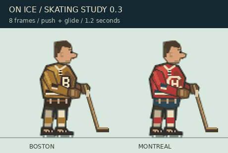

# On Ice: A Winter Classic — prototyp 0.3

PC hokej inšpirovaný rokmi 1924–1927. Godot 4.6, GDScript, bez externých závislostí.

## Spustenie

1. Nainštaluj Godot 4.6 (štandardná verzia, .NET nie je potrebný).
2. Importuj súbor `project.godot` do Godotu.
3. Stlač F6 pre otvorenú hlavnú scénu alebo F5 pre celý projekt.
4. Enter spustí tréningový zápas.

Príkazový riadok: `godot --path cesta/k/on-ice`

## Nové vo verzii 0.3

- Viac než dvojnásobne dlhé a širšie ihrisko; záber ukazuje len časť plochy.
- Plynulá bočná kamera sleduje hru a pri rýchlej strele mierne predvída smer puku.
  Na oboch koncoch sa zastaví tak, aby bola bránka v zábere.
- Malá mapa pod skóre ukazuje celú plochu, hráčov, puk a aktuálny záber kamery.
- Väčšie pôvodné postavy: samostatné SVG obrázky 96 × 112 pre každý tím,
  tiene a záhyby dresu, pracovný klubový znak, číslo, tvár bez prilby,
  rukavice, pruhované štucne, šnurovanie a oceľové nože korčúľ.
- Osem fáz odrazu a sklzu. Celý cyklus trvá približne 1,1–1,8 sekundy podľa
  rýchlosti; pri pustení smeru prechádzajú nohy do pokojného sklzu.

Ukážka zobrazuje postavy zväčšené pre kontrolu detailov. V hre ich veľkosť
mierne závisí od vzdialenosti od kamery. Znaky a dresy sú pracovný výtvarný
návrh, nie overená rekonštrukcia konkrétnej sezóny.

## Bočný 2,5D pohľad

Kamera je pri bočnom mantineli. Dlhá os ihriska ide zľava doprava; hĺbka ľadu
je perspektívne stlačená. Hráči sa zobrazujú z profilu v plnej výške, vzdialení
sú menší. Bránky majú zvislé žrde a mantinely viditeľnú výšku. Hráči a puk sa
kreslia podľa vzdialenosti od kamery. Šípky hore/dole stále ovládajú pohyb
do hĺbky plochy, vľavo/vpravo pohyb pozdĺž ihriska.

Simulácia zostáva oddelená od projekcie kamery, takže zmena pohľadu nemení
rýchlosť puku, kolízie ani vyhodnotenie gólu. Grafika je stále dočasná.

## Ovládanie

- Šípky: pohyb so zotrvačnosťou a brzdením.
- C s pukom: prihrávka najbližšiemu spoluhráčovi a prevzatie jeho ovládania.
- C bez puku: prepnutie na najbližšieho iného korčuliara k puku.
- Medzerník: strela smerom na súperovu bránku.
- X: vypichnutie puku súperovi v dosahu.
- Escape: pauza / pokračovanie.
- R: nový zápas.

Ovládaš Boston (zlatá farba), útočíš doprava. Montreal ovláda AI.
Aktívny hráč má zlatý kruh a šípku. Brankári automaticky vyrážajú získaný puk.
Zápas trvá tri minúty. Po góle sa obnoví rozostavenie.

## Rozsah a historické východiská

Ide o technický prototyp: 3 korčuliari a brankár za každý tím, jednoduchá AI,
dočasná pixelová kresba prostredia, pôvodné detailnejšie postavy a vonkajšie ihrisko.
Boston a Montreal sú pracovné tímy v zvolenom období. Dresy nie sú historicky
zrekonštruované. Hra zatiaľ nesimuluje konkrétnu sezónu ani presné dobové pravidlá.
Nie sú implementované fauly (Y), tresty, pravidlá prihrávok, striedanie, celé zostavy,
sezóna, manažment, zvuk, ukladanie ani ovládač. Puk sa získava dotykom, góly sa
počítajú pri prechode voľného puku cez otvor bránky na koncovom mantineli.

## Ďalšie kroky

1. Používateľské overenie rýchlosti korčuľovania, odozvy a čitateľnosti puku.
2. Rozdelenie zápasu na samostatné scény hráča, puku, ihriska a rozhrania.
3. Výber konkrétnej sezóny 1924–1927 a zdokumentovanie pravidiel aj výnimiek.
4. Plné zostavy, lepšia AI brankárov, tresty a fauly.
5. Doladenie animácií a dobových dresov v Aseprite, zvuky a hlavné menu.

## Overenie

`godot --headless --path . --script res://scripts/smoke_test.gd`

Overuje vytvorenie tímov, strelu, prihrávku, oba góly, odraz od mantinelu,
získanie puku, pauzu, koniec času a 60 sekúnd simulácie bez neplatných súradníc.
Kontroluje tiež import väčších postáv, pomalšiu animáciu, rozšírené ihrisko,
plynulé sledovanie kamerou a viditeľnosť oboch bránok pri krajoch záberu.
Automatické overenie nehodnotí herný pocit ani vizuálnu kvalitu.

## Súbory

- `project.godot`: konfigurácia projektu.
- `main.tscn`: hlavná scéna.
- `scripts/match.gd`: simulácia, ovládanie, AI a dočasná kresba.
- `scripts/smoke_test.gd`: automatické kontroly.

- `art/skaters/`: upraviteľné pôvodné SVG postavy (postoj + 8 fáz za tím).
- `tools/generate_skaters.py`: zdroj kresby a generátor obrázkov bez závislostí.
- `art/README.md`: súradnice dresu a postup pri zmene výtvarného návrhu.
- `docs/skating-preview.gif`: zväčšená ukážka animačného cyklu.
